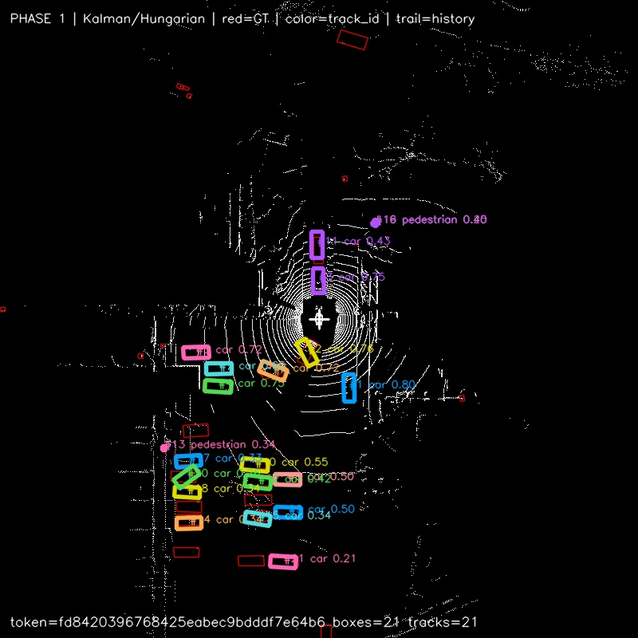
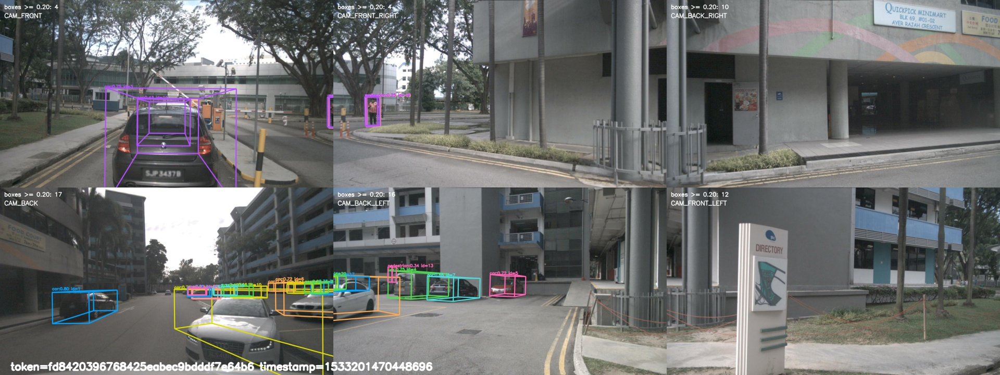

# BEVPerception

Camera–LiDAR BEV perception research stack for 3D vehicle and VRU detection,
followed by online 3D tracking.

The current implementation is intentionally split into two bounded phases:

1. **Phase 1 — BEVFusion + Kalman/Hungarian:** BEVFusion produces 3D boxes;
   a class-aware constant-velocity tracker assigns `track_id`, velocity and
   metric history with ego-motion compensation.
2. **Phase 2 — temporal-query prototype:** the frozen BEVFusion `pts_neck`
   feature is captured, the previous BEV is ego-pose warped into the current
   frame, and persistent query embeddings are sampled at tracked object
   centers. This validates the TrackFormer-style interface before training a
   learned TrackFormer head. It is not presented as a trained UniAD checkpoint.

MotionFormer, OccFormer, Planner and full UniAD are outside the current scope.

## Checkpoint 2 (current): VRU 3D detection + tracking, official nuScenes metrics

Pipeline: 6 cameras + LiDAR → frozen BEVFusion → temporal BEV (ego-aligned,
motion-gated) → **A** Kalman/Hungarian or **B** UniAD-style TrackFormer (a port
verified against UniAD, trained on BEVFusion features). Everything is evaluated
with the official nuScenes devkit.

| Test set | BEVFusion VRU mAP | A: AMOTA / VRU AMOTA | B: AMOTA / VRU AMOTA |
|---|---:|---:|---:|
| mini_val (2 scenes, 81 frames) | 0.743 | 0.741 / 0.676 | 0.530 / 0.321 |
| val-23 (23 trainval val scenes, 914 frames) | 0.761 | 0.589 / 0.626 | 0.536 / 0.485 |

Checkpoint-1 detection and tracking numbers below are **superseded**. They
came from inputs without LiDAR sweeps and with stale camera images
(`reports/phase_00_audit.md`).

* Reports: `reports/phase_00_audit.md` … `reports/phase_05_evaluation.md`,
  `reports/final_technical_report.md`
* Handoff: `docs/handoff/checkpoint_2.md`
* End-to-end live run:
  `python scripts/cp2_online_pipeline.py --tracker {query,kf} --output-dir <dir> [--render <dir>]`

## Current bounded run

The local evidence run deliberately does not scan the complete datasets:

- NavSim shard 5: 10 consecutive frames.
- Native nuScenes: `scene-0003` and `scene-0004`, 80 complete keyframes total.

The repository keeps four small representative images below so the README
renders on GitHub. The complete per-frame outputs and metrics remain local-only
under the ignored `artifacts/` directory.

### Phase 1 visual examples




### Phase 2 visual examples




The local evidence folders also contain per-frame images, camera/BEV montages,
`tracks.json`, `metrics.json` and `evidence.md`:

```text
artifacts/phase_runs/navsim_shard5/phase1/
artifacts/phase_runs/navsim_shard5/phase2/
artifacts/phase_runs/nuscenes_shard1/phase1/
artifacts/phase_runs/nuscenes_shard1/phase2/
```

The metrics are bounded center-distance and instance-token diagnostics. They
are not full-split nuScenes AMOTA/AMOTP or leaderboard results.

## Environment

The tested runtime is the `ai_core` Conda environment:

- Python 3.10.22
- PyTorch 2.1.0 + CUDA 12.1
- MMCV 2.1.0 with CUDA ops
- MMEngine 0.10.7
- MMDetection 3.2.0
- MMDetection3D 1.4.0
- nuScenes devkit 1.2.0

The external MMDetection3D checkout is expected at
`/home/anhhd/GIT/mmdetection3d` and contains the BEVFusion project.

Set local paths without committing them:

```bash
cp .env.example .env
# Edit .env with NUSCENES_ROOT, MMDETECTION3D_ROOT and BEVFUSION_CHECKPOINT.
```

## Bounded inference commands

NavSim smoke run:

```bash
PYTHONPATH=src:scripts conda run -n ai_core python scripts/phase12_navsim_infer.py \
  --record-pkl /path/to/navsim_logs/mini/<sequence>.pkl \
  --sensor-root /path/to/navsim_workspace/dataset/sensor_blobs/mini \
  --checkpoint /path/to/bevfusion_demo_mmdet3d.pth \
  --config /home/anhhd/GIT/mmdetection3d/projects/BEVFusion/configs/bevfusion_lidar-cam_voxel0075_second_secfpn_8xb4-cyclic-20e_nus-3d.py \
  --output-dir artifacts/phase_runs/navsim_shard5 \
  --limit 10 --score-thr 0.20 --device cuda:0
```

Native nuScenes bounded run:

```bash
PYTHONPATH=src:scripts conda run -n ai_core python scripts/phase12_nuscenes_infer.py \
  --data-root /path/to/nuscenes \
  --version v1.0-trainval \
  --scene-name scene-0003 --scene-name scene-0004 \
  --frame-limit 100 \
  --checkpoint /path/to/bevfusion_demo_mmdet3d.pth \
  --config /home/anhhd/GIT/mmdetection3d/projects/BEVFusion/configs/bevfusion_lidar-cam_voxel0075_second_secfpn_8xb4-cyclic-20e_nus-3d.py \
  --output-dir artifacts/phase_runs/nuscenes_shard1 \
  --score-thr 0.20 --device cuda:0
```

## Tests

```bash
PYTHONPATH=src conda run -n ai_core python -m pytest -q tests
```

The repository contract keeps units explicit: metres for positions and sizes,
metres/second for velocity, radians for yaw, timestamps in microseconds at the
dataset boundary, and an explicit coordinate frame on serialized detections.
